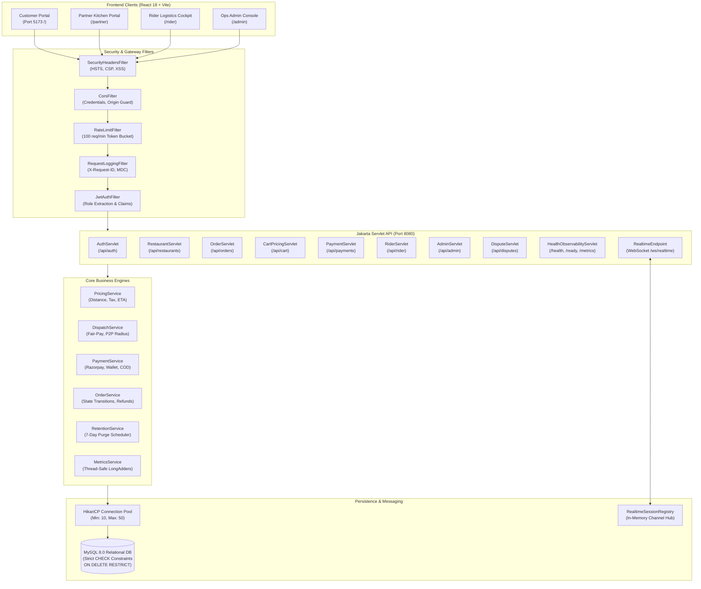

# CravePulse | India's Fair Food Network

A production-grade, real-time multi-portal food delivery platform engineered with **Java 17 (Jakarta Servlets 6.0, JDBC, HikariCP, MySQL 8)** on the backend and **React 18 (Vite, Bootstrap 5, Leaflet OpenStreetMap, HTML5 Canvas, Web Audio API)** on the frontend.

Designed with **zero Spring Boot, zero Hibernate/JPA, and zero Lombok**, the architecture relies on direct low-overhead JDBC `PreparedStatements`, pessimistic concurrency locking (`SELECT ... FOR UPDATE`), double-entry atomic ledger transactions, and bidirectional Jakarta WebSocket (`@ServerEndpoint`) synchronization.

---

## Architecture Diagram



---

## 1. Quick Start

### Prerequisites
- **Java Development Kit (JDK) 17+**
- **Apache Maven 3.8+**
- **Node.js 18+** & **npm 9+**
- **MySQL Server 8.0+** running locally on port `3306`

### 1. Database Setup
Create the target MySQL database:
```sql
CREATE DATABASE IF NOT EXISTS food_delivery_db CHARACTER SET utf8mb4 COLLATE utf8mb4_unicode_ci;
```

### 2. Configure Environment Variables
Copy example configurations:
```bash
cp .env.example .env
cp backend/src/main/resources/application.properties.example backend/src/main/resources/application.properties
```

Ensure `application.properties` or environment variables contain valid database credentials:
```properties
db.url=jdbc:mysql://localhost:3306/food_delivery_db?useSSL=false&allowPublicKeyRetrieval=true&serverTimezone=UTC&characterEncoding=UTF-8
db.username=root
db.password=your_db_password
jwt.secret=YourSuperSecretKeyThatIsAtLeast32BytesLongForHMACSHA256Signing!
server.port=8080
```

### 3. Start Backend API
```bash
cd backend
mvn exec:java -Dexec.mainClass="com.foodplatform.ServerMain"
```
> [!NOTE]
> All Flyway-style SQL migrations (`V1` through `V11`) apply automatically on server startup.

### 4. Optional: Load Multi-City Realistic Demo Data
To populate 27 authentic restaurants, full menus across Bangalore, Hyderabad, and Mumbai, riders, and historical orders:
```bash
mysql -u root -p food_delivery_db < scripts/seed-demo.sql
```

### 5. Start Frontend Dev Server
```bash
cd frontend
npm install --legacy-peer-deps
npm run dev
```
Open **`http://localhost:5173`** in your browser.

---

## 2. Real Demo Accounts (Seeded)

All demo accounts share the uniform test password credential: `Password@123` *(never used in production)*.

| Portal | Role | Email | Profile / Focus |
|---|---|---|---|
| **Customer App** | `CUSTOMER` | `customer@foodora.com` | Consumer order discovery, cart, live tracking |
| **Customer App** | `CUSTOMER` | `ananya.customer@cravepulse.com` | Multi-city customer (Bangalore) |
| **Partner Portal** | `RESTAURANT_OWNER` | `chef@foodanalytics.com` | Spice Symphony Indiranagar kitchen management |
| **Delivery Cockpit** | `RIDER` | `rider@swiftlogistics.com` | Captain delivery cockpit & Fair-Pay earnings |
| **Delivery Cockpit** | `RIDER` | `karthik.rider@cravepulse.com` | Electric Scooter Captain (Bangalore zone) |
| **Ops Admin Console** | `ADMIN` | `admin@foodplatform.com` | Fleet radar, telemetry, user directory, disputes |

---

## 3. Feature Implementation Matrix

| Module | Feature | Status | Notes |
|---|---|---|---|
| **Security & Auth** | JWT Access & Refresh Tokens | **Done** | HS256, atomic DB revocation in `user_tokens` |
| **Security & Auth** | Role-Based Access Control (RBAC) | **Done** | Strict portal guard (`CUSTOMER`, `RESTAURANT_OWNER`, `RIDER`, `ADMIN`) |
| **Security & Auth** | Rate Limiting | **Done** | In-memory token bucket (100 req/min per IP) |
| **Discovery** | Cross-Dish & Kitchen Search | **Done** | SQL subqueries across menus and restaurants with suggestions |
| **Discovery** | Location Picker & Geolocation | **Done** | Multi-city coordinates + HTML5 Geolocation API |
| **Menu & Orders** | Item Customizer & Special Notes | **Done** | Portion variants, addons, and kitchen cooking instructions |
| **Menu & Orders** | Radical Price Parity | **Done** | 100% price transparency (dine-in price vs platform price) |
| **Checkout** | 100% Tip Pass-Through | **Done** | 0% platform commission on rider tips |
| **Checkout** | Dynamic Coupon Engine | **Done** | Min order, usage limits, first-order guard, percentage & flat discounts |
| **Payments** | Razorpay Gateway Integration | **Done** | Order creation, signature HMAC verification, webhook idempotency |
| **Payments** | In-App CravePulse Wallet | **Done** | Atomic double-entry debit/credit transaction ledger |
| **Payments** | Cash On Delivery (COD) | **Done** | Platform order ceiling limit check (₹2000 default) |
| **Tracking** | Real-Time State Machine | **Done** | 9-stage lifecycle: PLACED → ACCEPTED → PREPARING → READY → PICKED_UP → DELIVERED |
| **Tracking** | Delivery OTP Verification | **Done** | Secure 4-digit numeric OTP required before marked DELIVERED |
| **Tracking** | Live Rider Telemetry Map | **Done** | Leaflet OpenStreetMap with GPS pings over WebSockets |
| **Tracking** | Masked Calling & In-App Chat | **Done** | Order-scoped messaging and masked platform phone dialers |
| **Partner Portal** | Kitchen Kanban Board | **Done** | Audio alert chime, prep time confirmation, SLA countdown timer |
| **Partner Portal** | Menu Management | **Done** | API-only CRUD, variants, add-ons, soft deletes, bulk sold-out |
| **Partner Portal** | Settlement Statements | **Done** | Gross sales, commission deductions, GST, and UTR reference ledger |
| **Rider Portal** | Fair-Pay Dispatch Protocol | **Done** | Transparent upfront breakdown: base fare + distance + surge + 100% tips |
| **Rider Portal** | Wait-Time Compensation | **Done** | ₹2/min compensation credited for restaurant delays > 8 minutes |
| **Rider Portal** | COD Cash Settlement Ledger | **Done** | Running cash-in-hand accumulation and cash deposit tracking |
| **Admin Console** | Real-Time Fleet & Order Radar | **Done** | Live GPS map coordinates of online riders and active dispatches |
| **Admin Console** | User Directory & Moderation | **Done** | Account suspension and fraud risk escalation counters |
| **Admin Console** | Rule-Based Dispute Engine | **Done** | Auto-refund caps, 2-hour window checks, and fraud flag evaluation |
| **Admin Console** | Platform Levers & CSV Export | **Done** | Dynamic fees, GST, search radius, and RFC 4180 streaming exports |
| **Database** | Strict Constraints & Retention | **Done** | MySQL 8.0 `CHECK` constraints, non-cascade FKs, 7-day telemetry purge |
| **Observability** | Request ID & Probes | **Done** | `X-Request-ID` propagation, SLF4J MDC, `/health`, `/ready`, `/metrics` |
| **Advanced** | Group Ordering & Scheduled Orders | **Planned** | Tracked in product roadmap for v1.2 |
| **Advanced** | Multi-Language Localization | **Planned** | Hindi / Telugu / Kannada UI translation pipeline |

---

## 4. Environment Variables Reference

| Variable | Type | Default | Description |
|---|---|---|---|
| `SERVER_PORT` | Integer | `8080` | Port for embedded Tomcat API server |
| `DB_URL` | String | `jdbc:mysql://localhost:3306/food_delivery_db...` | JDBC database connection URI |
| `DB_USER` | String | `root` | Database username |
| `DB_PASSWORD` | String | *(empty)* | Database password |
| `JWT_SECRET` | String | *(required)* | 256-bit secret for signing HMAC JWT tokens |
| `JWT_EXPIRATION_HOURS` | Integer | `24` | Access token lifespan in hours |
| `RAZORPAY_KEY_ID` | String | `rzp_test_placeholder` | Razorpay Merchant ID for payments |
| `RAZORPAY_KEY_SECRET` | String | `rzp_secret_placeholder` | Razorpay signature verification secret |
| `DISPATCH_MAX_RADIUS_KM` | Double | `15.0` | Maximum dispatch search radius in km |
| `WAIT_COMPENSATION_RATE` | Double | `2.00` | Wait-time compensation per minute (INR) |

---

## 5. API Reference & Documentation

Comprehensive API documentation with request/response schemas is available in [docs/API.md](file:///c:/Users/ragip/OneDrive/Desktop/100_Days_Full_Stack_Dev_Challenge/Food_delivery_application/docs/API.md).

Key Endpoint Groups:
- **Authentication:** `POST /api/auth/register`, `POST /api/auth/login`, `POST /api/auth/refresh`, `POST /api/auth/logout`
- **Catalog & Discovery:** `GET /api/restaurants`, `GET /api/restaurants/{id}`, `GET /api/restaurants/suggestions`
- **Pricing & Cart:** `POST /api/cart/calculate`
- **Orders & Tracking:** `POST /api/orders`, `GET /api/orders/{id}`, `POST /api/orders/{id}/cancel`, `POST /api/orders/{id}/verify-otp`
- **Payments & Webhooks:** `POST /api/payments/razorpay/create-order`, `POST /api/payments/razorpay/verify`, `POST /api/payments/webhook`
- **Rider Dispatch:** `GET /api/rider/offers`, `POST /api/rider/offers/{id}/accept`, `POST /api/rider/offers/{id}/reject`, `POST /api/rider/location`
- **Partner Operations:** `GET /api/restaurants/my-profile`, `GET /api/partner/orders`, `POST /api/menu/item`
- **Admin Control Room:** `GET /api/admin/metrics`, `GET /api/admin/live-map`, `GET /api/admin/users`, `POST /api/admin/settings`
- **Platform Observability:** `GET /health`, `GET /ready`, `GET /metrics`

---

## 6. Testing & CI/CD Pipeline

The project enforces automated testing across both backend and frontend layers:

### Running Backend Tests
```bash
cd backend
mvn test
```
- **75 Automated Depth Tests** covering pricing engines, order state machines, payment webhooks, concurrency pessimistic locking (`SELECT ... FOR UPDATE`), idempotency key deduplication, RBAC authorization matrix, and telemetry retention policies.

### Running Frontend Tests
```bash
cd frontend
npm test
```
- **13 Vitest Component & Logic Tests** covering cart state reducers, single-restaurant cart conflicts, checkout form validation, COD monetary thresholds, and route-level authorization guards.

### End-to-End Playwright Tests
```bash
cd frontend
npx playwright test
```
- Covers customer order flows, kitchen kanban state transitions, rider dispatch acceptance, and admin verification dossiers.

### GitHub Actions CI
All commits trigger the automated workflow at `.github/workflows/ci.yml`:
1. **Backend Job:** Compiles Java 17, runs MySQL 8 service container, executes test suite, packages executable.
2. **Frontend Job:** Installs dependencies, runs Vitest unit tests, builds Vite production bundle, runs `npm audit`.
3. **Security Job:** Gitleaks automated secret detector scanning for accidental key commits.

---

## 7. Known Limitations & Architectural Notes

1. **In-Memory WebSockets:** WebSockets operate via `RealtimeSessionRegistry` within a single JVM process. For multi-node cluster scaling, sessions must be bridged using a Redis Pub/Sub backplane.
2. **Third-Party SMS/Voice Gateway:** OTP delivery and masked calls utilize simulated platform proxies in the demonstration environment. Connecting to Twilio or Exotel requires setting `SMS_GATEWAY_API_KEY`.
3. **Map Coordinates:** Geolocation simulation defaults to central Bangalore/Hyderabad/Mumbai when browser location permissions are denied.
