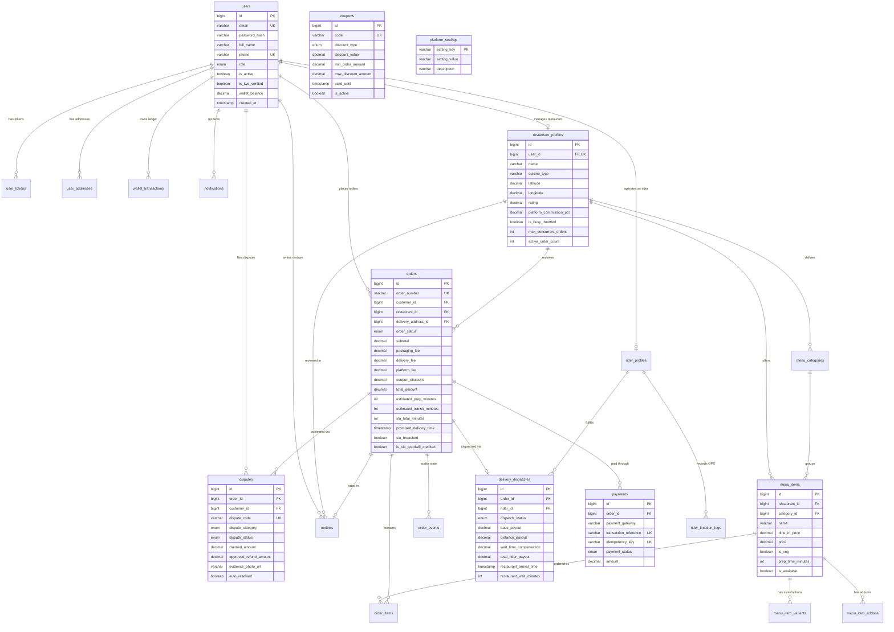
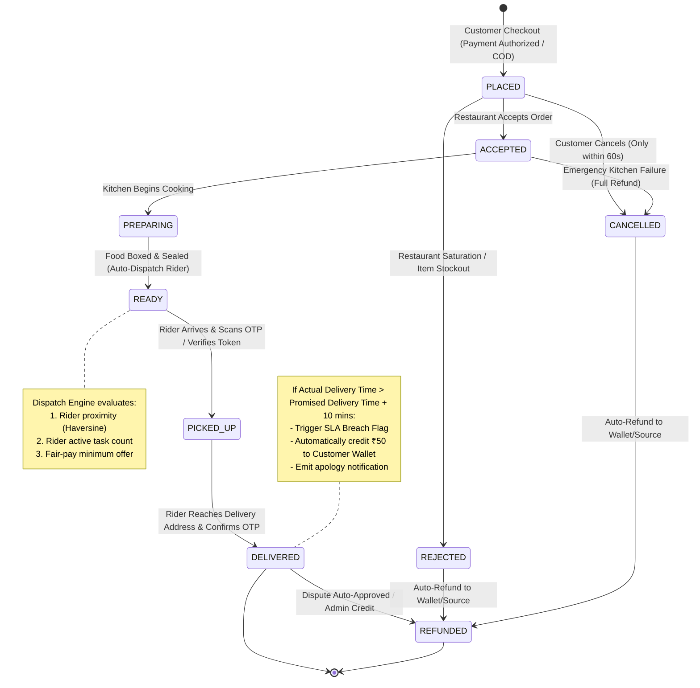

# Architecture Specification: Real-Time Food Delivery Platform

This document outlines the architectural blueprints, technical layers, state machines, concurrency strategies, database entity relationships, and security threat models for the platform.

---

## 1. High-Level System Architecture

The platform follows an enterprise **Layered Monolith** pattern designed without high-level abstraction frameworks (no Spring Boot, no Hibernate/JPA, no Lombok). It leverages low-latency, thread-per-request Jakarta Servlets 6.0 running on embedded Apache Tomcat 10, backed by HikariCP connection pooling and MySQL 8.0 InnoDB.

```mermaid
flowchart TD
    subgraph Clients["Frontend Portals (React 18 + Vite)"]
        CP["Customer Portal (/)"]
        PP["Partner Portal (/partner)"]
        RP["Rider Portal (/rider)"]
        AP["Admin Portal (/admin)"]
    end

    subgraph Gateway["Servlet Container (Tomcat 10 / Jakarta 6.0)"]
        direction TB
        subgraph Filters["Filter Pipeline"]
            F1["CorsFilter (CORS headers, pre-flight OPTIONS)"]
            F2["RequestLoggingFilter (MDC tracing, latency measurement)"]
            F3["RateLimitFilter (Token-bucket per IP / Token)"]
            F4["JwtAuthFilter (Bearer token parsing & SecurityContext)"]
        end

        subgraph Servlets["REST & Realtime Gateways"]
            S_AUTH["AuthServlet (/api/auth/*)"]
            S_REST["RestaurantServlet (/api/restaurants/*)"]
            S_MENU["MenuServlet (/api/menu/*)"]
            S_CART["CartPricingServlet (/api/cart/*)"]
            S_ORD["OrderServlet (/api/orders/*)"]
            S_RID["RiderServlet (/api/riders/*)"]
            S_ADM["AdminServlet (/api/admin/*)"]
            S_DISP["DisputeServlet (/api/disputes/*)"]
            S_REV["ReviewServlet (/api/reviews/*)"]
            S_INV["InvoiceServlet (/api/invoices/*)"]
            WS_RT["RealtimeEndpoint (/ws/realtime)"]
            S_SSE["SseServlet (/api/realtime/sse)"]
        end
    end

    subgraph CoreEngine["Service Layer (Business Rules & Orchestration)"]
        S_AUTH_SVC["AuthService"]
        S_PRICING_SVC["PricingService (Parity & Honest ETA)"]
        S_OSM_SVC["OrderStateMachineService (Locks & Events)"]
        S_DISP_SVC["DispatchService (Fair-Pay & Wait Meter)"]
        S_DISPUTE_SVC["DisputeService (Auto-Refund Rules)"]
        S_ANALYTICS_SVC["AnalyticsService (FoodAnalytics Aggregator)"]
    end

    subgraph DataAccess["DAO Layer (Direct JDBC PreparedStatements)"]
        DAO_USER["UserDao"]
        DAO_REST["RestaurantDao"]
        DAO_MENU["MenuDao"]
        DAO_ORD["OrderDao (SELECT FOR UPDATE)"]
        DAO_RID["RiderDao"]
        DAO_DISP["DisputeDao"]
        DAO_REV["ReviewDao"]
        DAO_WAL["WalletDao (Atomic Balance Delta)"]
    end

    subgraph Persistence["Storage & Pool"]
        HIKARI["HikariCP Connection Pool (Max 20, MinIdle 5)"]
        MYSQL[("MySQL 8.0 InnoDB Database")]
    end

    Clients <-->|REST JSON & WebSocket| Gateway
    Filters --> Servlets
    Servlets --> CoreEngine
    CoreEngine --> DataAccess
    DataAccess --> HIKARI
    HIKARI --> MYSQL
```



---

## 2. Request Lifecycle & Filter Pipeline

Every inbound HTTP request traverses an ordered sequence of Jakarta Servlet Filters before reaching the target controller servlet:

```mermaid
sequenceDiagram
    autonumber
    actor Client as Web Client / Mobile
    participant Cors as CorsFilter
    participant Log as RequestLoggingFilter
    participant Rate as RateLimitFilter
    participant Auth as JwtAuthFilter
    participant Servlet as Target Servlet
    participant Service as Business Service
    participant DB as MySQL (via HikariCP)

    Client->>Cors: Inbound Request (HTTP Method, Headers, Cookies)
    Note over Cors: Validates Origin, sets Access-Control-Allow-*, terminates OPTIONS 200 OK
    Cors->>Log: Filter Chain Next
    Note over Log: Generates Request ID, logs method, URI, remote IP
    Log->>Rate: Filter Chain Next
    Note over Rate: Token-bucket check (100 req/min per IP, 429 Too Many Requests if exceeded)
    Rate->>Auth: Filter Chain Next
    Note over Auth: Inspects Authorization: Bearer <JWT>; verifies HMAC-SHA256 signature;<br/>attaches UserPrincipal to HttpServletRequest
    Auth->>Servlet: Servlet service(req, res)
    Servlet->>Service: Call domain method with transaction context
    Service->>DB: Execute SQL with explicit connection commit/rollback
    DB-->>Service: Return ResultSets / affected rows
    Service-->>Servlet: Domain Model / DTO
    Servlet-->>Client: 200 OK + JSON payload
    Note over Log: Calculates total execution time (ms) and logs HTTP status
```

---

## 3. Real-Time Communication & WebSocket Architecture

Real-time bidirectional synchronization is powered by Jakarta WebSocket (`@ServerEndpoint("/ws/realtime")`) with an in-memory topic subscription registry.

### 3.1 Channel Topology

Clients subscribe to structured channel topics upon connection or on demand:

| Channel Pattern | Intended Consumer | Broadcast Events |
|---|---|---|
| `order:{orderId}` | Customer, Restaurant, Assigned Rider | `ORDER_UPDATED`, `STATUS_CHANGED`, `RIDER_LOCATION`, `RIDER_ASSIGNED` |
| `restaurant:{restaurantId}` | Restaurant Kitchen Staff | `NEW_ORDER` (with chime tone payload), `ORDER_CANCELLED` |
| `rider:{riderId}` | Delivery Partner | `NEW_JOB_OFFER` (with upfront pay breakdown), `JOB_CANCELLED` |
| `admin:ops` | Platform Operations Team | `DISPUTE_FIRED`, `SLA_BREACH`, `EMERGENCY_ALERT`, `NEW_PARTNER_PENDING` |

### 3.2 WebSocket Lifecycle

```mermaid
sequenceDiagram
    autonumber
    actor Client as React Client (RealtimeContext)
    participant WS as RealtimeEndpoint (/ws/realtime)
    participant Reg as RealtimeSessionRegistry
    participant Svc as Dispatch / Order Service

    Client->>WS: Upgrade Connection (GET /ws/realtime?token=JWT)
    WS->>WS: Validate JWT token; extract userId & role
    WS->>Reg: register(sessionId, Session, userId, role)
    WS-->>Client: 101 Switching Protocols (Connection Established)

    Client->>WS: Send JSON: {"action":"SUBSCRIBE", "channel":"restaurant:1"}
    WS->>Reg: subscribe(sessionId, "restaurant:1")
    WS-->>Client: {"type":"SUBSCRIBED", "channel":"restaurant:1"}

    Note over Svc: Customer places order #402 for restaurant #1
    Svc->>Reg: broadcastToChannel("restaurant:1", {"type":"NEW_ORDER", "orderId":402, "bill":750.00})
    Reg-->>Client: Push Text Message Frame (instant audio cue & Kanban update)

    loop Heartbeat (Every 30s)
        Client->>WS: {"action":"PING"}
        WS-->>Client: {"type":"PONG"}
    end

    Client-xWS: Network Disconnection
    WS->>Reg: unregister(sessionId)
```

---

## 4. Concurrency & Race Condition Strategy

To withstand real-world production conditions without data corruption, ghost allocations, or balance leaks, the application adheres to strict concurrency invariants:

### 4.1 Strict Row-Level Locking (`SELECT ... FOR UPDATE`)
Order updates and rider job acceptances must acquire pessimistic write locks at the database level:
```sql
SELECT * FROM orders WHERE id = ? FOR UPDATE;
SELECT * FROM delivery_dispatches WHERE id = ? FOR UPDATE;
```
This guarantees that if two delivery riders attempt to tap "Accept Order" simultaneously, the second transaction is forced to wait until the first commits, at which point the dispatch status is already `ACCEPTED` and the second request is safely rejected with HTTP 409 Conflict.

### 4.2 Explicit Transaction Management
No DAO method relies on auto-commit. Multi-table modifications are wrapped in explicit database transactions:
```java
Connection conn = DatabaseConfig.getConnection();
try {
    conn.setAutoCommit(false);
    // 1. Lock and update order status
    // 2. Insert into order_events audit trail
    // 3. Update restaurant balance or issue wallet credit
    conn.commit();
} catch (Exception e) {
    conn.rollback();
    throw e;
} finally {
    conn.setAutoCommit(true);
    conn.close();
}
```

### 4.3 Unique Constraints & Single Assignment Guarantees
- A unique constraint on `delivery_dispatches(order_id, status)` prevents multiple active assignments for the same delivery task.
- A unique index on `payments(idempotency_key)` guarantees that duplicate webhook callbacks from payment gateways never trigger multiple order creations or double refunds.

### 4.4 Atomic Balance Deltas
Customer and rider digital wallets are updated through atomic delta operations:
```sql
UPDATE users SET wallet_balance = wallet_balance + ? WHERE id = ?;
```
Combined with a database constraint `CHECK (wallet_balance >= 0)`, this prevents race-condition double spends.

---

## 5. Entity Relationship (ER) Diagram

The platform schema consists of **21 normalized tables** implementing foreign keys, check constraints, cascade protections, and indexes optimized for geolocation and state lookups:



---

## 6. Order State Machine

The order lifecycle is strictly enforced by `OrderStateMachineService.java`. Direct or arbitrary database status mutations are disallowed; all valid state transitions require specific caller roles and log a permanent immutable record in `order_events`.



---

## 7. Role-Based Access Control (RBAC) Matrix

Access permissions are enforced programmatically in `JwtAuthFilter` and verified inside individual Servlets:

| Endpoint Resource | Customer | Restaurant Partner | Delivery Rider | Platform Admin | Unauthenticated |
|---|:---:|:---:|:---:|:---:|:---:|
| `POST /api/auth/register` | ✅ | ✅ | ✅ | ❌ | ✅ |
| `POST /api/auth/login` | ✅ | ✅ | ✅ | ✅ | ✅ |
| `GET /api/restaurants` | ✅ | ✅ | ✅ | ✅ | ✅ |
| `POST /api/cart/price` | ✅ | ❌ | ❌ | ❌ | ❌ |
| `POST /api/orders` | ✅ | ❌ | ❌ | ❌ | ❌ |
| `GET /api/orders/{id}` | ✅ (Own) | ✅ (Own Rest.) | ✅ (Assigned) | ✅ (All) | ❌ |
| `PUT /api/orders/{id}/status` | ❌ | ✅ (`ACCEPTED`, `PREPARING`, `READY`) | ✅ (`PICKED_UP`, `DELIVERED`) | ✅ (Any) | ❌ |
| `POST /api/disputes` | ✅ (Own) | ❌ | ❌ | ❌ | ❌ |
| `PUT /api/disputes/{id}/resolve`| ❌ | ❌ | ❌ | ✅ | ❌ |
| `GET /api/riders/jobs` | ❌ | ❌ | ✅ (Active) | ✅ | ❌ |
| `POST /api/riders/location` | ❌ | ❌ | ✅ | ❌ | ❌ |
| `GET /api/admin/metrics` | ❌ | ❌ | ❌ | ✅ | ❌ |
| `PUT /api/admin/approvals` | ❌ | ❌ | ❌ | ✅ | ❌ |
| `GET /api/invoices/{id}` | ✅ (Own) | ✅ (Own Rest.) | ❌ | ✅ | ❌ |

---

## 8. Threat Model & Security Posture

### 8.1 SQL Injection Hardening
- **Vulnerability:** Unsanitized user inputs in queries could allow unauthorized read/write access.
- **Mitigation:** Strict ban on SQL string concatenation. All SQL execution is mediated exclusively through `java.sql.PreparedStatement` with typed binding (`setInt`, `setString`, `setBigDecimal`). Codebase undergoes zero-dynamic-query verification.

### 8.2 Cross-Site Scripting (XSS)
- **Vulnerability:** Malicious script injection in customer reviews, delivery instructions, or dish descriptions.
- **Mitigation:** All frontend inputs are rendered through React’s automated string-escaping virtual DOM. Response headers include `X-Content-Type-Options: nosniff` and `Content-Type: application/json; charset=UTF-8`.

### 8.3 Cross-Site Request Forgery (CSRF) & CORS Policy
- **Vulnerability:** Unauthorized cross-origin requests made on behalf of an authenticated user.
- **Mitigation:** Token-based stateless authentication (`Authorization: Bearer <JWT>`) stored in client memory/secure storage, immune to ambient cookie-based CSRF attacks. Explicit CORS filter restricts `Access-Control-Allow-Origin` to trusted frontend domains and rejects wildcard origins on authenticated endpoints.

### 8.4 JWT Authentication & Refresh Token Rotation
- **Access Tokens:** Signed using HMAC-SHA256 with a 256-bit cryptographically random secret; short 1-hour time-to-live (TTL).
- **Refresh Tokens:** High-entropy random tokens stored in the `user_tokens` table with SHA-256 hash, valid for 7 days.
- **Rotation:** Upon refresh token usage, the token is revoked and a new pair is issued immediately. If an already-revoked refresh token is re-presented, all sessions for that user ID are invalidated immediately (token family theft detection).

### 8.5 Denial of Service & Rate Limiting
- **Implementation:** In-memory sliding token-bucket rate limiter (`RateLimitFilter`) permits up to 100 requests per minute per IP address. Exceeded limits trigger an immediate `429 Too Many Requests` status with a `Retry-After` header.

### 8.6 Cryptographic Storage of Passwords
- **Algorithm:** OpenBSD BCrypt algorithm (`jBCrypt`) with work factor (cost) 10 and cryptographically secure pseudorandom salt.
- Plaintext passwords never cross the service layer boundary and are excluded from all logging and serialization outputs.
